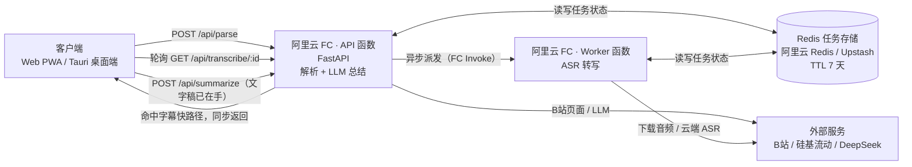

# video-to-text

基于 Serverless 架构的视频转文字与 AI 总结工具。粘贴一个 B站链接，从几秒（命中字幕）到几分钟（走 ASR）拿到带时间戳的文字稿与结构化 AI 摘要。

- **零成本字幕快路径**：视频有 CC / AI 字幕时直接取，27 分钟视频 5-7 秒出稿，¥0
- **分层降级流水线**：字幕快路径（秒级 ¥0）→ 语音识别（云端优先、本机自建可走 faster-whisper）→ LLM 总结，逐层兜底不空手
- **真实 AI 结构化总结**：一句话概要 / 带时间戳要点 / 章节笔记，时间戳锚定原文；三档详细度（精简 / 标准 / 详细）可随时切换，切换会重新生成而不是裁剪旧结果
- **三种安装形态**：Web PWA（配好可达域名后可装到主屏幕）、Windows 桌面安装包（Tauri）、Android APK（Capacitor）——后两者资源随包分发，**不依赖域名可达性**
- **桌面端自动更新**：Windows 版启动后自动检查新版本，顶栏提示一键下载安装，装一次之后不用再手动找安装包；下载与安装始终由你点确认，不会偷偷占带宽
- **手机上也能导出**：App 内点导出会拉起系统分享面板（存到文件 / 发给微信），不再依赖浏览器下载——`blob:` 下载在 WebView 里根本不会落地
- **从 B站 App 直接分享过来**：在 B站 点「分享 → 视频转文字」，链接直接进转写，不用先复制再切回来粘贴（这是安装版相对网页版的实际便利）
- **深色模式与自适阅读**：浅色 / 深色 / 跟随系统三档；全文可调字号、搜索高亮、按章节跳转
- **字幕文件导出**：除阅读用的 TXT / Markdown（零时间戳）外，还可导出 SRT / VTT 字幕，直接挂到播放器；两类产物语义相反，入口分组、绝不混用
- **最近转写**：首页记住最近 8 条任务，关掉标签页也能找回；转写期间误关会先确认一次
- **进度页给的是真实反馈**：当前阶段剩余时间预估、按阶段自动退避的轮询（10 秒内 800ms → 之后 3s）、切到后台暂停轮询
- **自带 API Key（BYOK，可自由换服务商）**：右上角「API 设置」可填自己的 **Key + 接口地址 + 模型名**，任何兼容 OpenAI `chat/completions` 的服务商都能用（DeepSeek / 百炼 / Moonshot / 智谱 / 硅基流动 / OpenAI / 自建中转），用各自的额度、不占站点配额；Key 只存在本机浏览器，生成总结时随请求头发给后端，不进请求体、不落库、不写日志。语音识别用的是免费模型，不需要填 Key
- **直接输入视频号**：`BV1xx411c7mD`、`av170001` 这类裸号可以直接粘进首页输入框，不必凑出完整链接
- **热词可选填**：人名 / 产品名 / 专业术语（逗号或顿号分隔，最多 12 个）会进语音识别的提示词，减少「听得见音但猜错字」；命中字幕快路径时用不到，其余流程不受影响
- **限流有明确说法**：触发 429 时显示「请求太频繁」并给出冷却倒计时，冷却期内禁用重试（重试本身也是 POST，必然再撞限流）

| | 入口 |
| --- | --- |
| 在线体验 | <https://video-to-text-six.vercel.app> |
| 桌面端下载（Windows） | [**v0.1.7 · .exe 直链**](https://github.com/Ling-cn111/video-to-text/releases/download/v0.1.7/video-to-text_0.1.7_x64-setup.exe) ／ [全部 Release](https://github.com/Ling-cn111/video-to-text/releases/latest) |
| 手机端下载（Android） | [**v0.1.7 · .apk 直链**](https://github.com/Ling-cn111/video-to-text/releases/download/v0.1.7/video-to-text_0.1.7_android.apk) — 3.8 MB，Android 7.0+，覆盖安装即可升级 |

### 桌面端下载

当前版本 **v0.1.7**，点文件名直接下载（无需先进 Release 页找）：

- [**video-to-text_0.1.7_x64-setup.exe**](https://github.com/Ling-cn111/video-to-text/releases/download/v0.1.7/video-to-text_0.1.7_x64-setup.exe) — 3.5 MB，NSIS，普通用户双击安装，**无需管理员权限**（推荐）
- [**video-to-text_0.1.7_x64_zh-CN.msi**](https://github.com/Ling-cn111/video-to-text/releases/download/v0.1.7/video-to-text_0.1.7_x64_zh-CN.msi) — 4.8 MB，WiX，适合企业组策略 / 静默分发

校验和（`certutil -hashfile <文件> SHA256`）：

```
<待 v0.1.7 产物发布后按实际下载字节填入>  video-to-text_0.1.7_x64-setup.exe
<待 v0.1.7 产物发布后按实际下载字节填入>  video-to-text_0.1.7_x64_zh-CN.msi
```

> **不写死旧版本的校验和**：CI 构建与本地构建的字节不同（MSI 内嵌时间戳等），
> 抄上一版的哈希会让真心校验的用户以为自己下到了坏包。发版后按 Release 实际资产重算。

> **请使用 v0.1.7**：首页可以填热词引导语音识别认准专有名词；APK 改由 CI 与桌面端同一次发版产出，不会再出现「桌面端已更新、手机端还是旧的」。已装旧版的用户可在顶栏「检查更新」（手机端在设置面板「版本更新」）里升级。详见 [v0.1.7 Release 说明](https://github.com/Ling-cn111/video-to-text/releases/tag/v0.1.7)。
> 安装包未做代码签名，Windows SmartScreen 会提示「未知发布者」，点「更多信息 → 仍要运行」即可。
> 安装后不依赖域名可达性：桌面端直接连后端 API，不受 `*.vercel.app` 被墙影响。
> `github.com` 在国内可能连不上，若下载失败需自备代理；网页端本身不受此影响。更新检查也走 GitHub，连不上时会静默跳过，可在顶栏「检查更新」里手动重试或打开发布页。

### 手机端（Android）

**已发布安装包**：下载 [**video-to-text_0.1.7_android.apk**](https://github.com/Ling-cn111/video-to-text/releases/download/v0.1.7/video-to-text_0.1.7_android.apk)（3.8 MB）传到手机安装即可，无需 Android Studio，也不需要域名可达。

校验和（`sha256sum <文件>`）：

```
<待 v0.1.7 产物发布后按实际下载字节填入>  video-to-text_0.1.7_android.apk
```

> 安装包已用固定 keystore 签名，后续版本可直接覆盖升级；首次安装需在系统里允许「安装未知来源应用」。
> 手机上装的是**本地资源**，所以 `*.vercel.app` 被墙不影响 App 使用；只有 API 请求需要联网（后端在阿里云 FC，可达）。
> **从 B站 分享**：在 B站 App 里点「分享」→ 选「视频转文字」，链接直接进转写（不用先复制再切回来）。分享文案里带多条链接时会挑出真正的视频页，`b23.tv` 短链由后端展开。
> **检查更新**：设置面板底部「版本更新」能看到当前版本、手动检查、有新版时给下载入口。

现状：

| 方式 | 状态 |
| --- | --- |
| Android APK（Capacitor 包壳） | **已发布** ✅ 前端资源打进安装包，直连后端 API，**不依赖域名可达性**。见上方直链 |
| PWA 装到主屏幕（Android） | 功能已实现，但 `*.vercel.app` 被 SNI 阻断，国内手机上 `beforeinstallprompt` 不会触发，**实际装不上** |
| PWA 装到主屏幕（iOS） | 即使域名可达也**不会出现「安装应用」按钮**：iOS Safari 从不触发 `beforeinstallprompt`，顶栏入口因此不显示。需手动走「分享 → 添加到主屏幕」 |
| 换自定义域名后装 PWA | 可行，域名解析后 Android 的安装按钮即刻出现（无需打包）；iOS 仍需上面的手动步骤 |
| iOS 包壳 | **未启动**：打包必须有 macOS + Xcode，当前开发机是 Windows |

也就是说：Android 已有独立 App（不需要域名）；iOS 目前只能通过浏览器访问网页。

**自行构建 Android APK**（需要 JDK 17+ 与 Android SDK，无需 Android Studio）：

```bash
pnpm install
pnpm build:mobile                 # 静态导出到 out/，注入 NEXT_PUBLIC_USE_MOCK=false
npx cap sync android              # 把 out/ 复制进 android/app/src/main/assets/public/
cd android
./gradlew --init-script gradle/init-mirrors.gradle assembleDebug   # 产物：app/build/outputs/apk/debug/
```

发布版签名：把 `android/keystore.properties.example` 复制成 `keystore.properties` 并填入 keystore 路径与密码，然后 `assembleRelease`。**keystore 必须备份**——丢了之后已安装用户永远无法升级。

> **日常发版不用自己跑这些**：推 `v*` tag 会触发 `release-desktop.yml`，桌面端与 APK 都由 CI 构建并上传到同一个 Release。
> 上面的命令是本地想先看一眼产物时才用。

> **`--init-script gradle/init-mirrors.gradle` 不能省**：Capacitor 子工程的 `build.gradle` 把 `google()` 排在最前，
> 直连 `dl.google.com` 在国内会卡十几分钟再超时失败。这个 init script 在子工程脚本求值前插入阿里云镜像。

构建方法见 [桌面端打包指南](docs/desktop-packaging.md)（静态导出与后端地址注入的共用逻辑）。

## 架构



**为什么必须异步**：ASR 要 30-155 秒（长视频更久），而 API 函数超时是 300 秒；更关键的是 FC 在 HTTP 响应返回后会**冻结/回收实例**，`BackgroundTasks` 挂的后台协程拿不到 CPU——超时配多大都没用。因此 API 只做「解析 + 派发」并立即返回 `taskId`，作业体投交给独立的 Worker 函数（超时 1800 秒、单实例并发 1），前端轮询状态。**LLM 总结留在 API 侧**（`/api/summarize`）：它只依赖已经落库的文字稿，不需要重新下载音频，放 API 可以直接复用同一实例处理完；Worker 因此只管 ASR 这一件重活。设计推演见 [异步架构侦察报告](docs/s2-async-recon.md)。

## 快速开始

### 桌面端

1. 从上表下载当前版本安装包，双击安装（无需管理员权限）
2. 从开始菜单打开「视频转文字」，粘贴 B站链接即可使用
3. **之后不用再手动下载**：客户端会在启动后自动检查新版本，顶栏出现「更新到 x.y.z」时点一下即可下载安装（v0.1.5 起支持；从 v0.1.4 及更早版本升级需手动装这一次）

> 自行构建的话，产物在 `src-tauri/target/release/bundle/`（`msi/` 与 `nsis/` 两个子目录），
> 不在仓库根的 `dist/`。分发请以 [Release 资产](https://github.com/Ling-cn111/video-to-text/releases/latest) 为准，
> 不要拿本地历史遗留的旧包——版本对不上时用户装到的是已经修复过的故障。
> 自建分发的更新清单用 `node scripts/make-latest-json.mjs --version X.Y.Z` 生成，需先设置 `TAURI_SIGNING_PRIVATE_KEY` 让构建产出 `.sig`。

### 本地开发（Web）

```bash
# 前端
pnpm install
cp .env.example .env.local     # 见下表，至少确认 NEXT_PUBLIC_USE_MOCK
pnpm dev
```

```bash
# 后端（另开终端）
cd backend
python -m venv .venv && source .venv/bin/activate   # Windows: .venv\Scripts\activate
pip install -r requirements.txt
uvicorn app.main:app --reload --port 8000
```

打开 <http://localhost:3000>。首页提供示例链接，含失败与不支持平台的演示。

最核心的三个变量（全表见 [`.env.example`](.env.example)）：

| 变量 | 默认 | 作用 |
| --- | --- | --- |
| `NEXT_PUBLIC_USE_MOCK` | `true` | **构建期常量**。`false` 时走真实后端（经 `/backend-api/*` 同源代理） |
| `BACKEND_ORIGIN` | `http://localhost:8000` | 服务端变量，仅 Next rewrites 使用，不暴露给浏览器 |
| `NEXT_PUBLIC_API_BASE` | 空 | 桌面端专用，静态导出后跨域直连后端的绝对地址 |

后端另需在 `backend/.env.local` 配 `CLOUD_ASR_API_KEY`（云端转写，硅基流动的 ASR 模型免费，Key 仍需免费注册）与 `DEEPSEEK_API_KEY`（AI 总结），两者均可选。**AI 总结 Key 建议不配**：本站设计上让使用者填自己的 Key（右上角「API 设置」），站点不配时总结区会直接引导填写；未配置的对应功能会明确提示。

> **Windows 用户**：双击 `setup.bat` 一键装好全部依赖，再用 `控制台.bat` 启动托盘控制台。细节见 [本地开发指南](docs/local-development.md)。

## 核心逻辑

### 四条路径与成本

| 路径 | 触发条件 | 耗时（27 分钟视频） | 成本 | 质量 |
| --- | --- | --- | --- | --- |
| ① 字幕快路径（**主路径**） | B站视频有 CC / AI 字幕 | **5-7 秒** | ¥0 | B站官方字幕，接近人工 |
| ② 云端 ASR（自动兜底） | 无字幕，站点或请求头有云端 ASR Key | 19-43 秒（150s 音频） | ¥0（硅基流动 ASR 免费） | 4-17% CER（绝对基准） |
| ③ 本地 ASR（自建部署可选） | 无字幕，且后端装了 faster-whisper | 36-155 秒（150s 音频） | ¥0 | 清晰口播 6-22% CER，喊叫类 44% |
| ④ LLM 总结 | 转写完成后自动触发（需可用 LLM Key） | 33-69 秒 | **¥0.07 / 27 分钟视频**（唯一成本项） | 结构化概要 / 要点 / 章节 |

前三层是降级关系（有字幕就不跑 ASR），走哪条由后端按实际可用性决定：线上镜像只装云端 ASR，
所以永远是 ①→②；本地自建装好 faster-whisper 后多一层 ③。数据来源：[ASR 基准](docs/asr-benchmark.md) / [LLM 成本记录](docs/llm-cost.md)。

### 两条开发铁律

- **任务页 URL 只能由 [`src/lib/routes.ts`](src/lib/routes.ts) 生成**（`resultHref()` / `processingHref()`）。手拼 `/result/${id}` 在桌面端会 404，因为静态导出改用查询参数形态。
- **导出与「全文阅读」同源且零时间戳**。TXT / MD 必须与页面全文视图逐段一致，改任一侧都要同步另一侧。

## 项目结构

```
backend/                  # FastAPI + yt-dlp 服务（详见 backend/README.md）
└── app/                  # parse / url_guard(SSRF 守卫) / platforms / services/
src/
├── app/                  # 路由与 Mock API（/、/processing?id=、/result?id=、/api/*）
├── components/           # home / processing / result / shared / layout / pwa / ui
├── lib/                  # types(契约) api(出口) real-api http(请求层) mock-*
│                         # platforms(平台注册表) article(分段) export(导出) format
├── stores/task-store.ts  # Zustand 任务状态机
└── hooks/                # 轮询等
e2e/                      # Playwright 功能锁定用例
src-tauri/                # Tauri 桌面端壳
```

技术栈：Next.js 14（App Router）+ TypeScript + Tailwind + shadcn/ui + Zustand；后端 FastAPI + yt-dlp + faster-whisper + DeepSeek/Qwen；PWA 用 Web App Manifest + Service Worker（仅生产环境注册）。

## 部署

**前端（Vercel）**：GitHub 导入仓库即可，框架自动识别 Next.js。仅需两个环境变量——`BACKEND_ORIGIN`（后端地址）与 `NEXT_PUBLIC_USE_MOCK=false`，两者均为**构建期生效**，事后修改必须重新部署。

**后端（阿里云 FC）**：容器镜像 + `s.yaml` 双函数（API / Worker），完整流程见 [serverless-deploy.md](docs/serverless-deploy.md)。

## 文档索引

| 想了解 | 去看 |
| --- | --- |
| 后端 FC 部署全流程（镜像构建、`s.yaml`、VPC、变量、验收） | [docs/serverless-deploy.md](docs/serverless-deploy.md) |
| 本地开发与日常运行（Windows 脚本、托盘、故障排查） | [docs/local-development.md](docs/local-development.md) |
| 测试指南（lint / build / E2E / pytest） | [docs/testing.md](docs/testing.md) |
| 前端功能锁定协议与回归清单 | [docs/frontend-features.md](docs/frontend-features.md) |
| API 契约（接口 / 错误码 / 路由约定） | [docs/api-contract.md](docs/api-contract.md) |
| 桌面端打包指南（WiX / NSIS / 国内镜像） | [docs/desktop-packaging.md](docs/desktop-packaging.md) |
| Android 包壳的不变量与踩坑 | [docs/frontend-features.md](docs/frontend-features.md) 第 16 节 |
| 系统分享接收（intent-filter、短链还原） | [docs/frontend-features.md](docs/frontend-features.md) 第 17 节 |
| 桌面端自动更新（签名、发版流程、不变量） | [docs/frontend-features.md](docs/frontend-features.md) 第 15 节 |
| ASR 准确率评测基准（绝对 CER） | [docs/asr-benchmark.md](docs/asr-benchmark.md) |
| 异步架构改造侦察报告 | [docs/s2-async-recon.md](docs/s2-async-recon.md) |
| LLM 成本记录 | [docs/llm-cost.md](docs/llm-cost.md) |
| 后端 API / 环境变量 / 容器化 | [backend/README.md](backend/README.md) |
| 路线图与阶段验收 | [ROADMAP](docs/ROADMAP.md) · [阶段二](docs/acceptance-stage-2.md) · [阶段三](docs/acceptance-stage-3.md) |

## 已知限制

- **仅支持 B站**，抖音解析目前只在前端 Mock 中预置，真实后端待接入
- B站 AI 字幕非全覆盖（实测 6 个视频中 5 个有轨道），无字幕时走 ASR 兜底
- 本地 ASR 依赖 CPU：small 模型处理 150 秒音频约需 36-155 秒（含冷启动，见 [ASR 基准](docs/asr-benchmark.md)）
- **云端镜像不含本地 ASR**（`backend/requirements-cloud.txt` 刻意排除 faster-whisper / torch），所以网页端与桌面端只有「字幕快路径 → 云端 ASR」两级；`ASR_ENGINE_FALLBACK=local` 在线上是空转，代码里已加探测（`local_engine_available()`）避免白等
- **云端 ASR 的免费是「刊例价 0 元」**（硅基流动 `free-asr-model` 系列，按千字符计），不排除服务商后续调价；换模型时请重新核对价格页
- 云端部署时若 `REDIS_URL` 连不上，应用会静默降级到内存存储，表现为任务永远停在 `processing`
- PWA 在国内手机暂不可安装：`*.vercel.app` 被 DNS 污染与 SNI 阻断，需换自定义域名
- 桌面端安装包未做代码签名，SmartScreen 会提示「未知发布者」；**v0.1.5 起有自动更新**（检查走 GitHub，国内可能连不上，此时静默跳过，可手动点「检查更新」）
- **Android 安装包未上应用商店**，只发在 GitHub Release（需自行下载 APK 侧载，国内访问 `github.com` 可能需代理）；iOS 需 macOS + Xcode，未启动
- Android 包的最低系统要求是 **Android 7.0（API 24）**，targetSdk 36；自行打包需 JDK 21 与 Android SDK（无需 Android Studio；本机工具链放在 `D:\vtt-toolchain`，路径由 `android/local.properties` 与 `android/keystore.properties` 指定，两者都不入库）

## 协作规范

- 分支：`main`（已开分支保护：禁止强推与删除，三组 CI 必须通过才能合并）← 功能分支，一个功能一个 PR（squash 合并）
- 提交信息遵循 [Conventional Commits](https://www.conventionalcommits.org/zh-hans/)（`feat:` / `fix:` / `chore:` / `docs:` / `ci:`）
- PR 会自动跑三组检查（[CI 配置](.github/workflows/ci.yml)）：`lint + build`、`backend tests`、`e2e locked features`。这三项是 GitHub 分支保护里的必需检查，未通过时合并按钮是灰的
- 改前端前请先读 [前端功能锁定协议](docs/frontend-features.md)，模板位于 `.github/`
